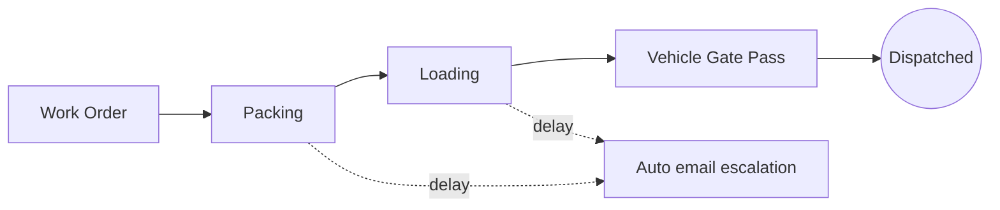

<div align="center">


<a href="mailto:Krishna.Raju@indo-tech.com"></a>
<a href="https://www.indo-tech.com/"></a>
<a href="https://krishna-ittl.github.io/Candidate-Screener/"></a>


</div>

---

## About

I build the internal software that runs day-to-day operations at **Indo Tech Transformers**: dispatch, testing, inspection tracking, hardware automation and HR tools. My focus is replacing spreadsheet-driven, manual work with dependable applications that people on the shop floor use every shift.

```yaml
role:      Software Developer
company:   Indo Tech Transformers Limited
focus:     [manufacturing workflows, process automation, internal tools]
approach:  secure by default, tested, built with the people who use it
```

## Impact

<table align="center">
<tr>
<td align="center" width="25%"><h2>9</h2><sub><b>APPS IN PRODUCTION</b><br/>across manufacturing operations</sub></td>
<td align="center" width="25%"><h2>2 h → 5 min</h2><sub><b>TEST PLANNING</b><br/>per transformer</sub></td>
<td align="center" width="25%"><h2>30 min → 30 s</h2><sub><b>HARDWARE BOM</b><br/>from PDF to Excel</sub></td>
<td align="center" width="25%"><h2>128</h2><sub><b>AUTOMATED TESTS</b><br/>guarding dispatch</sub></td>
</tr>
</table>

## Featured Projects

<table>
<tr>
<td width="50%" valign="top">

### 🚚 Dispatch Management System
Work order → packing → loading → vehicle gate pass, end to end. Five user roles, a dispatch calendar and automatic email escalations.

   

</td>
<td width="50%" valign="top">

### 🔍 [Job Lens](https://github.com/krishna-ITTL/Candidate-Screener)
Screens and ranks resumes against one consistent rubric, with ATS checks. Works fully offline or with an AI provider.

[](https://krishna-ittl.github.io/Candidate-Screener/)  

</td>
</tr>
<tr>
<td width="50%" valign="top">

### 🧰 [RTCC & M.Box Tracker](https://github.com/krishna-ITTL/RTCC-and-M.BOX-PROJECT)
Inspection, testing and clearance tracking for RTCC panels and marshalling boxes, with automatic 48-hour follow-up emails.

  

</td>
<td width="50%" valign="top">

### 🔩 [Fasteners Automation](https://github.com/krishna-ITTL/Fasteners-Project)
Drop in a hardware PDF and get a weighted fastener BOM as Excel and PDF. Hours of manual entry, removed.

 

</td>
</tr>
</table>

<details>
<summary><b>More projects</b></summary>
<br/>

| Project | Description | Stack |
|:--|:--|:--|
| [**Testing Data Acquisition**](https://github.com/krishna-ITTL/Testing-s-Data-Acquisition-) | Transformer test data capture with Excel export and QR tagging | React, Express, ExcelJS |
| [**Project Management System**](https://github.com/krishna-ITTL/Project-Management-System) | Projects, Gantt charts, milestones, tasks, daily reports and budgets | TypeScript, React, Express, Supabase |
| [**dMAT Practice**](https://github.com/krishna-ITTL/dmat-practice) · [Live](https://krishna-ittl.github.io/dmat-practice/) | Offline exam simulator with timed mock tests and weakness analysis | HTML, CSS, JavaScript |

</details>

<details>
<summary><b>How the dispatch workflow fits together</b></summary>
<br/>



</details>

## Tech Stack

<p align="center">
  <br/>
  
</p>

## GitHub Activity

<p align="center">
  
</p>

<div align="center">

**Have a manual process slowing your team down? Let's talk.**

<a href="mailto:Krishna.Raju@indo-tech.com"></a>

</div>


